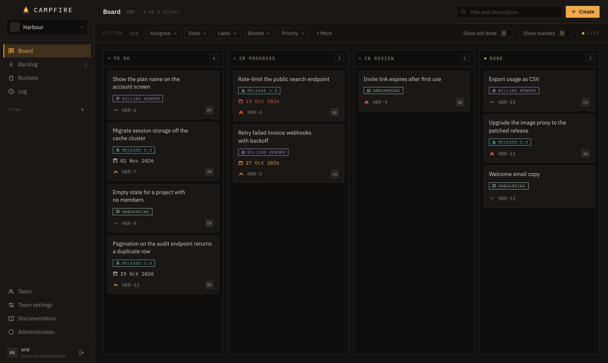
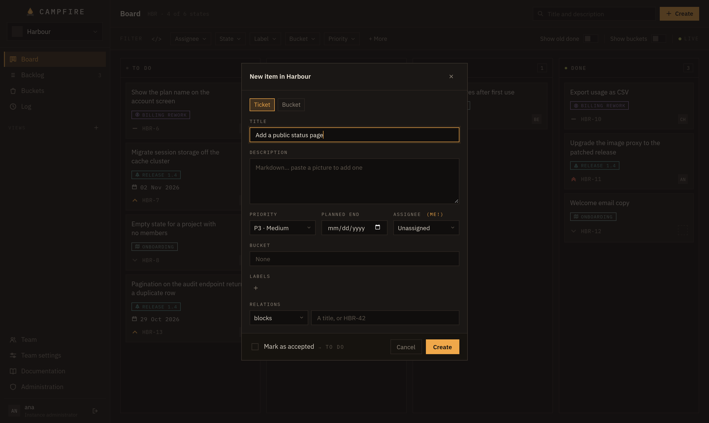
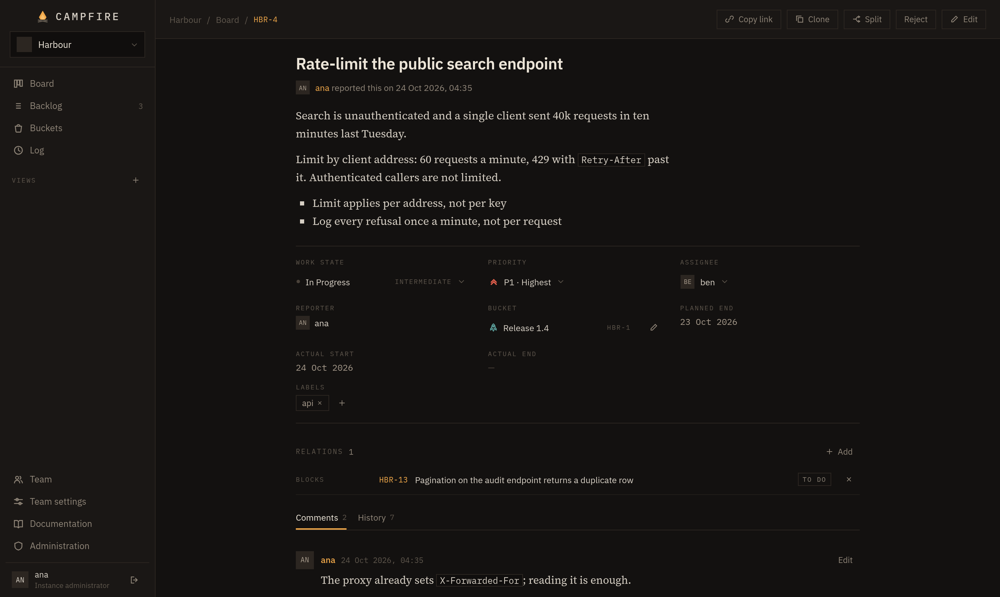
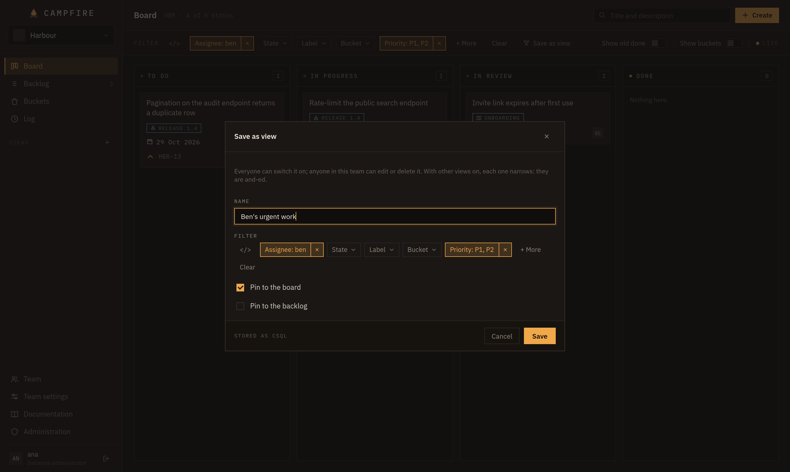
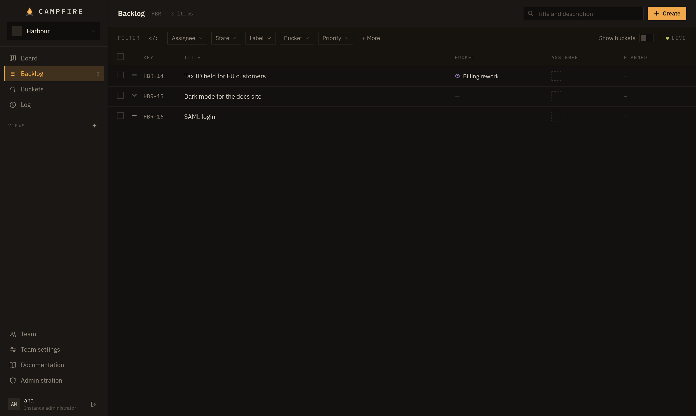
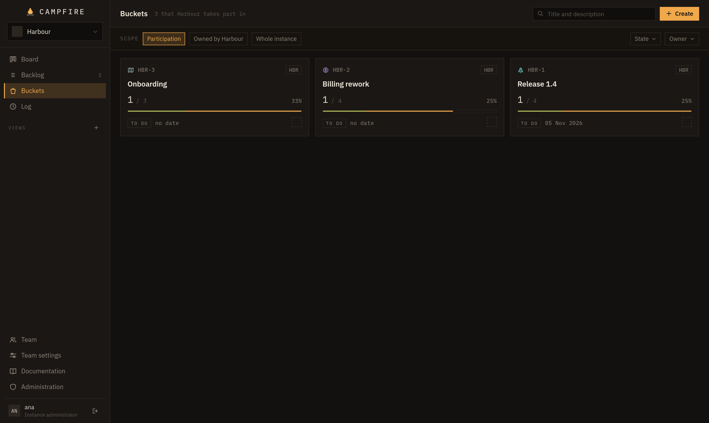
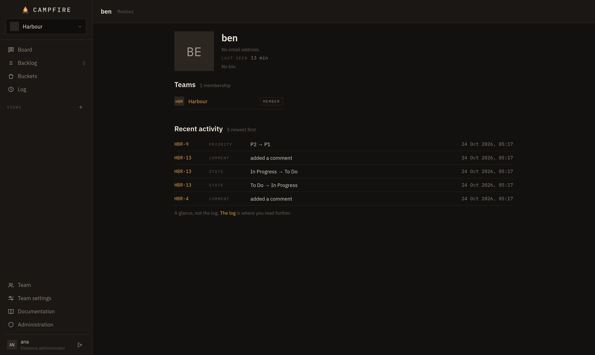

<p align="center"></p>

A kanban work tracker for individuals and small teams who host it themselves. One binary and one
data file, so a laptop and a shared server run it the same way.



### What it offers
- Task boards, backlog, filters
- Milestones (buckets)
- Live collaboration
- MCP & API for AI agents and third-party integrations
- Customizable work states
- Audit log
- Synced PR state from various forges (GitHub, GitLab, Codeberg, Forgejo, Gitea)
- Automatic backups & point-in-time restore
- Self-hosted, copyleft, free forever

### What it won't do
- Per-item access control
- Workflow rules
- Subtasks
- Native clients (desktop, mobile)

<details>
<summary><b>More screens</b></summary>

**Creating a ticket**


**Ticket page**


**Saving a filter as a view**


**Backlog**


**Buckets**


**User profile**

</details>

## Contents

- [Install](#install)
- [First run](#first-run)
- [Commands](#commands)
- [Configuration](#configuration)
- [Agents (MCP)](#agents-mcp)
- [Pull requests](#pull-requests)
- [Behind a proxy](#behind-a-proxy)
- [Backup and recovery](#backup-and-recovery)
- [Scale](#scale)
- [Contributing](#contributing)
- [License](#license)

## Install

Download the binary for your platform from the [latest release](https://github.com/33313/campfire/releases/latest):

```
curl -fLo campfire https://github.com/33313/campfire/releases/latest/download/campfire-linux-amd64
chmod +x campfire
./campfire
```

| Platform | File |
|---|---|
| Linux | `campfire-linux-amd64`, `campfire-linux-arm64` |
| macOS | `campfire-darwin-arm64` (Apple silicon), `campfire-darwin-amd64` (Intel) |
| Windows | `campfire-windows-amd64.exe`, `campfire-windows-arm64.exe` |

`SHA256SUMS` in the release checks the download: `sha256sum --ignore-missing -c SHA256SUMS`.

Linux is the primary platform. The binaries are not signed, so elsewhere the first run takes one
more step:

- **macOS** refuses a binary downloaded in a browser. Download with `curl` as above, or run
  `xattr -d com.apple.quarantine <file>` once.
- **Windows** SmartScreen warns about an unrecognised app: *More info*, then *Run anyway*.

Or run the container image, for `linux/amd64` and `linux/arm64`:

```
docker run -p 8080:8080 -v campfire-data:/data ghcr.io/33313/campfire
```

The image binds `0.0.0.0:8080`, since loopback inside a container reaches nobody, and keeps the
database and snapshots in `/data`. Otherwise it is the same application, configured the same way.

**Upgrading** is replacing the binary, or pulling the image, and restarting. Versions follow
[Semantic Versioning](https://semver.org); image tags are the version (`1.4.2`), its minor (`1.4`),
its major (`1`), and `latest`. [`CHANGELOG.md`](CHANGELOG.md) lists what each release changes.

## First run

Campfire prints an address. Open it and create the first account: that account is an instance
administrator. There is no setup wizard, no database to install, and no open registration
afterwards — an administrator creates accounts or hands out an invitation link.

## Commands

```
campfire                 # run the server (default)
campfire init            # write a configuration file with every setting in it
campfire check           # verify the database's integrity and exit
campfire snapshot        # take a snapshot now and exit
campfire restore <path>  # replace the data file with a snapshot
campfire version         # print the version and exit
```

`-config <path>` points at a configuration file other than the default.

## Configuration

One JSON file, in the operating system's data directory:

| OS | Path |
|---|---|
| Linux | `~/.local/share/campfire/campfire.json` |
| macOS | `~/Library/Application Support/Campfire/campfire.json` |
| Windows | `%LocalAppData%\Campfire\campfire.json` |

```json
{
  "addr": "127.0.0.1:8080",
  "database": "/home/you/.local/share/campfire/campfire.db",
  "snapshots": {
    "enabled": true,
    "dir": "/home/you/.local/share/campfire/snapshots",
    "interval": "6h",
    "keep": 14,
    "replica": ""
  },
  "mcp": { "enabled": false },
  "liveUpdates": { "hiddenTabGrace": "1m" },
  "images": { "maxMB": 10 },
  "updates": { "check": true }
}
```

Three defaults are worth knowing:

- **`addr` binds to loopback.** A binary run on a laptop must not silently serve the network it is
  attached to. Change it deliberately, and put a reverse proxy in front when you do.
- **`snapshots.enabled` is true.** Snapshots are online: no locking, no downtime, each verified as
  it is written.
- **`mcp.enabled` is false.** While it is off, `/mcp` is not served and an agent token
  authenticates nothing.

`liveUpdates.hiddenTabGrace` is how long a browser tab nobody is looking at keeps its live-update
connection. Past it the connection closes, and the tab catches up when it is shown again.

`images.maxMB` bounds a picture pasted into a description or a comment. Pictures are kept in the
database, so a backup is still one file; `0` turns them off.

`updates.check` asks GitHub once a day whether a newer release is out, and the administration
screen says so. The request carries nothing but the running version; `false` turns it off.

**The database must be on local disk.** Network filesystems (NFS, SMB) and cloud-synchronised
folders (Dropbox, iCloud Drive, OneDrive, Google Drive) are **unsupported**: SQLite's locking is not
honoured across them and the file corrupts, often silently and only under load. To keep the data
elsewhere, point `snapshots.replica` there and leave the live file local.

## Agents (MCP)

The server is the MCP server — same origin, same port, no second process.

1. **Enable it.** Set `mcp.enabled` to `true` and restart. The log line
   `agent interface (MCP) on /mcp` confirms it.
2. **Issue a token** on your account screen. It is shown once.
3. **Install it.** That same dialog shows the finished command:

   ```
   claude mcp add --scope user --transport http campfire \
     https://your-instance/mcp --header "Authorization: Bearer <token>"
   ```

   To keep the token out of the file, export it in your shell and pass
   `--header 'Authorization: Bearer ${CAMPFIRE_MCP}'` instead — the variable is read from the
   client's environment at call time.

A client configured with JSON wants the same three facts:

```json
{
  "mcpServers": {
    "campfire": {
      "type": "http",
      "url": "https://your-instance/mcp",
      "headers": { "Authorization": "Bearer <token>" }
    }
  }
}
```

A stdio-only client needs a bridge:
`npx -y mcp-remote https://your-instance/mcp --header "Authorization: Bearer <token>"`.

An agent acts as the person who issued the token, with exactly that person's permissions, resolved
on every call. It can create and edit tickets and buckets, move and rank them, manage bucket
membership, labels, relations, comments and saved views, and read boards, backlogs, buckets, items
and the log. It cannot create accounts, change teams or membership, reassign a bucket's owning
team, delete anything, take or restore backups, or issue tokens — those operations have no tool at
all. Every mutation records the token it arrived on; filter the log with the Agent chip to see what
agents did.

An instance bound to loopback is reachable only from its own machine, by an agent as much as by a
browser.

## Pull requests

A pull request whose title starts or ends with an item's identifier (`DEV-12: fix it`,
`[DEV-12] fix it`, `fix it DEV-12`) is listed on that item, with its state. Campfire reads them from
GitHub (and GitHub Enterprise), Forgejo, Gitea and GitLab, private repositories included.

1. **Make a token** on the forge, read-only:
   - GitHub: a fine-grained token that can read pull requests on the repositories to list, or a
     classic one with `repo`.
   - Forgejo or Gitea: `read:repository` and `read:user`.
   - GitLab: a personal, group or project token with `read_api`.

   The token sees what its user sees, so a bot account limited to a few repositories keeps Campfire
   to those.
2. **Add it.** *Administration → Integrations*: pick the forge (GitHub, GitLab, Codeberg, or a
   self-hosted one at its address, like `https://git.example.com`) and give the token. Campfire
   tries the token, then reads back the last 90 days at once; *Sync* does it again. GitHub and
   GitLab come two ways:
   - **Poll**: Campfire checks every 5 minutes, or as often as you choose. Nothing to set up on the
     forge, and it works for personal accounts, which GitHub can't send webhooks for, and for an
     instance the forge can't reach.
   - **Webhook**: instant, for organisations, groups and repositories.
3. **For a webhook,** add the address the screen shows with its secret (shown once; *Rotate* makes a
   new one), and Pull request events (Merge request events on GitLab). Forgejo and Gitea take one
   on your profile, an organisation or a repository. A forge that can't reach Campfire can't
   deliver; press *Sync*, or poll it instead.

When a token expires, *New token* replaces it and keeps the webhook, if there is one. Tokens and webhook secrets are
kept in the database, so a snapshot carries them. If a snapshot leaks, revoke the tokens on the
forges.

## Behind a proxy

The board updates in place over server-sent events. For that long-lived response to survive a
proxy:

1. **Response buffering off** for `/api/stream`. The server sends `X-Accel-Buffering: no`, which
   nginx honours; other proxies need it said explicitly.
2. **Idle read timeout above the heartbeat interval.** The server beats every 20 seconds, well
   inside the common 60-second default.
3. **File-descriptor limits allowing one open connection per active client**, plus headroom. Fifty
   people need nothing unusual; the default 1024 is thin at a few hundred. A tab left hidden past
   `liveUpdates.hiddenTabGrace` closes its connection.

The server compresses its own responses; the proxy need not.

```nginx
location /api/stream {
    proxy_pass http://127.0.0.1:8080;
    proxy_http_version 1.1;
    proxy_set_header Connection "";
    proxy_buffering off;
    proxy_cache off;
    proxy_read_timeout 1h;
}

location / {
    proxy_pass http://127.0.0.1:8080;
    proxy_set_header Host $host;
    proxy_set_header X-Forwarded-Proto $scheme;
}
```

Serve it over TLS. The session cookie is marked `Secure` when the request arrived over HTTPS, which
behind a proxy the server learns from `X-Forwarded-Proto`: set it, terminate TLS at the proxy, and
keep the instance on loopback behind it.

## Backup and recovery

- **Snapshots** run on `snapshots.interval` into `snapshots.dir`, keeping `snapshots.keep`. Each is
  a complete database file, verified when written and again whenever the administration screen
  lists it.
- **Any moment, off-host.** Set `snapshots.replica` to a second directory — a mount of another
  machine, an object-store gateway — and the write-ahead log is copied there continuously, within
  a second of each write, by [Litestream](https://litestream.io) running inside the server. The
  database can then be restored to any moment in the last `interval × keep` (14 × 6h, three and a
  half days, by default), even when the machine it ran on is gone.
- **Restoring** replaces the data file, which the running process holds open. Stop the server, run
  `campfire restore <snapshot>` for a snapshot, or `campfire restore -at "2026-10-03 14:05"` for a
  moment (`-at latest` for the newest the replica holds), and start it again. The administration
  screen shows the span the replica covers and writes the command for you. The replaced file is
  moved aside rather than deleted, so restoring the wrong moment is itself recoverable.
- **Integrity** is checked at startup and hourly. On corruption at startup the server refuses to
  start and names the snapshot to restore from.

There is no failover and no high availability: recovery from total host loss is restore time, in
minutes. Restarts take seconds, and sessions live in the database, so a restart logs nobody out.

## Scale

Sized for 10,000 registered users and ~3,000 active per day: about 100,000 writes a day, under two
per second on average and tens per second at peak; under 100 GB after five years with the audit log
included. One ordinary machine handles this with room to spare. Sharding, read replicas, a caching
tier and a job queue are not built, and should not be introduced without measurements contradicting
that.

## Contributing

```
./build.sh && ./campfire
```

`build.sh` compiles the Svelte client into `internal/web/app`, then builds the binary that embeds
it; Node is needed for that step only. `./build.sh release <version>` builds every released platform
into `dist/`. `go test ./...` covers the server; `npm test` runs the client's CSQL parser against the
same corpus as the server's; `npx playwright test` drives the built binary in a browser.

| Path | What is there |
|---|---|
| `main.go`, `backup.go`, `mcp.go` | The command: serve, init, check, snapshot, restore, version. |
| `internal/store` | The schema and every query. One SQLite file behind a single writer and a read pool. |
| `internal/csql` | CSQL, the filter language: parser, printer and compiler to SQL. `testdata/corpus.json` is what it and the client's parser must both say. |
| `internal/core` | The application. Every operation exists here exactly once, behind one permission check and one validation. |
| `internal/api` | The HTTP interface described by [`api/openapi.yaml`](api/openapi.yaml), plus the event stream. |
| `internal/mcp` | The agent interface: a second interface over the same handlers. |
| `internal/web` | The client — Svelte, built by Vite into `app/`, embedded and served by the server. |
| `internal/auth`, `internal/backup`, `internal/config`, `internal/stream` | Credentials, snapshots, the configuration file, and the fan-out hub. |
| `e2e` | The Playwright suite. It runs the real binary against a throwaway data directory and drives it in a browser. |
| `.changes` | Release notes: unreleased change files, and one file per release. |

Two documents are normative, and the tests cite them. [`SPEC.md`](SPEC.md) fixes behaviour — the
entities, permissions, lifecycle, API, storage and agent interface. [`DESIGN.md`](DESIGN.md) fixes
appearance — colour and type tokens, geometry, component states, icon paths. Where they appear to
disagree, `SPEC.md` wins on behaviour and `DESIGN.md` on appearance. The mockups `DESIGN.md`
describes are not in this repository; they live in `~/dev/.design/kanban/`, and `DESIGN.md`
supersedes them.

### Releases

Every merge into main that carries a change file is a release; nobody bumps a version or pushes a
tag by hand. A pull request adds one with `npm run changie -- new` (or, without prompts,
`npm run changie -- new --kind Fixed --body "…"`). changie is pinned in `package.json` and run
with `go run`, so there is nothing to install and nothing of it in `go.mod`.

From v1, a version promises compatibility for what other things depend on:

- **The data file.** A binary opens any data file, or snapshot, of its major version. There are no
  migrations, so any schema change is a major release.
- **The configuration file**: its keys and what they mean.
- **The command line**: commands, flags, and output a script reads (`campfire snapshot` prints the
  path of the snapshot).
- **The MCP tools**: names, arguments and result shapes.
- **Addresses kept outside the instance**: permalinks (`/SOL-42`), image addresses in item text
  (`/api/images/12`), a forge's webhook address, `/mcp`, and `/api/stream`, which proxies name.

The HTTP API is not covered. It has one client, served by the same binary, and any release may change
both together ([SPEC §11](SPEC.md#11-api-contract)), the live-update stream's payloads included.

The kind sets the bump. Breaking and Removed are incompatible changes to the covered surface:

| Kind | Bump |
|---|---|
| Breaking, Removed | major |
| Added, Changed, Deprecated | minor |
| Fixed, Security | patch |

A pull request that changes nothing for the people who run Campfire — tests, CI, contributor docs —
carries the `skip-changeset` label instead. The `changeset` check requires one or the other, and its
summary previews the release.

On the merge, [`release.yaml`](.github/workflows/release.yaml) writes `CHANGELOG.md`, commits and
tags `Release vX.Y.Z` with the deploy key in the `GH_DK` secret, pushes the image to ghcr.io, and
publishes the GitHub release with the binaries and `SHA256SUMS`. If it fails after the tag is
pushed, rerun it: it finishes a release that has no published GitHub release.

## License

Copyright (C) 2026 33313

Campfire is free software: you can redistribute it and/or modify it under the terms of the GNU
Affero General Public License, version 3 or (at your option) any later version. It comes with no
warranty. If you run a modified Campfire for others over a network, offer them its source. See
[`LICENSE`](LICENSE).

The sign-in page and the last section of the documentation link to the source. A modified Campfire
run for others complies by pointing [`internal/web/src/lib/source.js`](internal/web/src/lib/source.js)
and the *Source code* section of [`internal/web/src/docs.md`](internal/web/src/docs.md) at its own.

The bundled IBM Plex and Source Serif 4 fonts are under the SIL Open Font License 1.1; see
[`internal/web/static/fonts/OFL.txt`](internal/web/static/fonts/OFL.txt).
